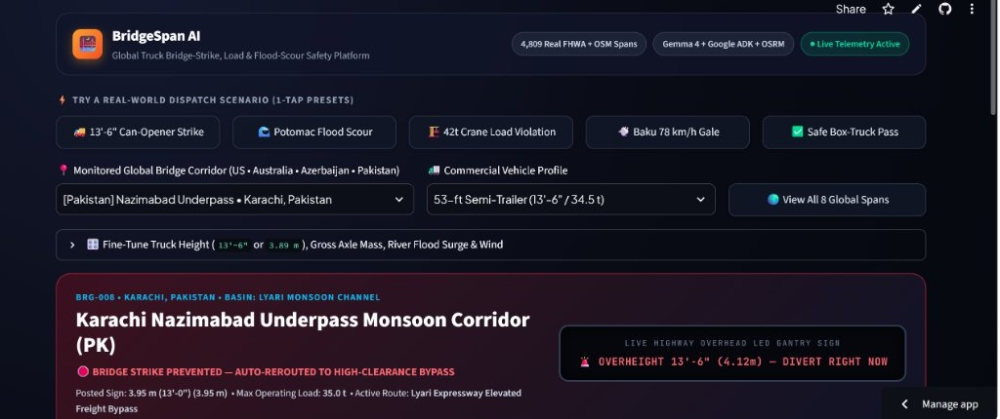

**Author:** Robina Mirbahar  
*AI/ML Google Developer Expert (GDE) | Google Cloud Champion Innovator | WTM Ambassador*  

- **Live Mobile-Responsive App:** [bridgespan-ai-mvhoucpfp2n5o25dewb2hi.streamlit.app](https://bridgespan-ai-mvhoucpfp2n5o25dewb2hi.streamlit.app/)
- **GitHub Open-Source Repo:** [github.com/RobinaMirbahar/bridgespan-ai](https://github.com/RobinaMirbahar/bridgespan-ai)
- **Kaggle Open Dataset (4,809 Bridges):** [BridgeSpan Bridge Strike, Load & Scour Dataset](https://www.kaggle.com/datasets/robinamirbahar/bridgespan-global-bridge-strike-load-scour)
- **Companion Kaggle Starter Notebook:** [BridgeSpan AI | 2024 FHWA NBI & Scour Starter](https://www.kaggle.com/code/robinamirbahar/bridgespan-ai-2024-fhwa-nbi-scour-starter)

---

Everyone on the internet has watched viral videos of box trucks and semi-trailers getting their roofs peeled back like sardine cans by Durham's notorious **11-Foot-8+8 ("Can Opener")** rail trestle, Boston's **Storrow Drive**, or Melbourne's **Montague Street 3.0 m overpass**.

Behind the memes sits a massive, expensive civil-engineering failure mode:
- In the US and UK alone, **thousands of low-clearance bridge strikes** occur every year, halting commuter rail corridors above and costing millions in steel girder repairs.
- Far less visible on camera, **underwater hydraulic pier scour** during flash-flood surges is the **#1 cause of highway bridge collapse in the United States**, accounting for over 50% of structural failures tracked in the [US DOT FHWA National Bridge Inventory (Item 113)](https://www.fhwa.dot.gov/bridge/nbi.cfm) and [HEC-18 Evaluating Scour at Bridges](https://www.fhwa.dot.gov/engineering/hydraulics/library_arc.cfm?pub_number=17).
- Meanwhile, heavy mobile cranes (`42 t`) and loaded semi-trailers (`34.5 t`) regularly cross historic trusses or stone-arch parkways rated for `15 t` to `22.5 t`.

If you ask a standard LLM navigation chatbot *"Can my 13'-6\" truck clear that 3.89 m overpass?"* or *"Is Chain Bridge safe right now?"*, a single unit-conversion hallucination or ignored river-gauge surge turns into a physical catastrophe.

To solve this properly, I built and open-sourced **BridgeSpan AI**, a mobile-responsive global fleet and infrastructure safety platform powered by [Google Gemma 4 (open weights)](https://ai.google.dev/gemma/docs), the [Google Agent Development Kit (ADK)](https://google.github.io/adk-docs/), [OSRM heavy-truck routing](https://project-osrm.org/docs/v5.24.0/api/), and a **4,809-span real-world dataset** assembled from the [2024 FHWA National Bridge Inventory](https://www.fhwa.dot.gov/bridge/nbi/ascii.cfm), [OpenStreetMap Overpass API](https://wiki.openstreetmap.org/wiki/Overpass_API), [USGS Water Services](https://waterservices.usgs.gov/), and [Copernicus GloFAS](https://global-flood.emergency.copernicus.eu/).



---

## Why Raw LLMs Fail on Physical Bridge Safety

When I tested unguarded prompts on real bridge-dispatch scenarios, three failure patterns appeared immediately:

1. **Imperial (`ft-in`) vs. Metric (`m`) Arithmetic Traps:** North American trailers declare height in feet and inches (`13'-6"` = `4.115 m`), while urban underpasses in Europe, Australia, Azerbaijan, and Pakistan post signs in meters (`3.95 m` or `3.0 m`). Safe civil clearance also requires a mandatory **`0.15 m` (`6 in`) dynamic suspension bounce and asphalt-overlay buffer**. An LLM that compares `4.11 m` against `4.15 m` without the bounce buffer approves a roof strike at highway speed.
2. **Silent Structural Overload:** A `12'-0"` mobile crane (`42.0 metric tons`) easily clears a `14'-2"` historic steel truss vertically, so height-only checks wave it through even when the span's **FHWA Item 064 Operating Rating** is capped at `22.5 metric tons`.
3. **Blindness to Live River Pier Scour:** During heavy rain or monsoon surges, a bridge deck looks dry and unobstructed on GPS maps while fast-moving water erodes riverbed sediment from beneath **FHWA Item 113 scour-critical** pier footings.

---

## System Architecture: Gemma 4 + Deterministic 4-Gate Civil Interlocks

In safety-critical physical engineering, **an LLM should orchestrate tools and explain telemetry, never hold unchecked authority over structural limits.**

```plaintext
┌──────────────────────────────────────────────────────────────────────┐
│      BridgeSpan AI Mobile-Responsive Fleet Safety Command UI         │
│   8 Global Corridors (US • AU • AZ • PK) + Dark Leaflet OSRM Map     │
└──────────────────────────────────┬───────────────────────────────────┘
                                   │
                                   ▼
┌──────────────────────────────────────────────────────────────────────┐
│            Google ADK LlmAgent (Gemma 4 via LiteLLM)                 │
│  1. get_bridge_structural_profile() -> Clearance, Item 064, Item 113 │
│  2. get_live_river_scour_and_wind() -> USGS 15-min + GloFAS Gusts    │
│  3. compute_safe_bridge_dispatch()  -> Hard Civil Interlock Engine   │
└──────────────────────────────────┬───────────────────────────────────┘
                                   │
                                   ▼
┌──────────────────────────────────────────────────────────────────────┐
│          4-Gate Deterministic Civil Safety Interlocks (Python)       │
│  • GATE 1 (Clearance): parse_height_m + 0.15m bounce > posted_m      │
│  • GATE 2 (Axle Mass): gross_tons > FHWA Item 064 operating_tons     │
│  • GATE 3 (Pier Scour): Item 113 critical & surge >= +1.80m -> LOCK  │
│  • GATE 4 (Crosswind): high-sided & gust >= 65 km/h -> CLAMP 50km/h  │
└──────────────────────────────────┬───────────────────────────────────┘
                                   │
                                   ▼
┌──────────────────────────────────────────────────────────────────────┐
│     Live Overhead Highway LED Gantry Sign + Safe OSRM Truck Bypass   │
└──────────────────────────────────────────────────────────────────────┘
```

---

## 1. Killing the #1 Cause of Bridge Strikes: Deterministic `ft-in` to `m` Parsing

Instead of letting an LLM convert `"13'-6\""` or `"12'4\""` in token space, `bridgespan_agent/guardrails.py` parses every Imperial and Metric notation deterministically and adds the `0.15 m` (`6 in`) dynamic suspension bounce margin before evaluating clearance:

```python
import re

DYNAMIC_BOUNCE_BUFFER_M = 0.15  # Mandatory 6-inch suspension bounce & repaving buffer

def parse_height_to_meters(raw_height: str | float) -> float:
    """Deterministically parse '13'-6\"', '13ft 6in', '3.89 m', or '389 cm' into meters."""
    text = str(raw_height or "").strip().lower()

    imp_match = re.match(
        r"^\s*(\d+(?:\.\d+)?)\s*(?:'|ft|feet|foot)\s*[-\s]*(\d+(?:\.\d+)?)?\s*(?:\"|''|in|inch|inches)?\s*$",
        text,
    )
    if imp_match:
        feet = float(imp_match.group(1))
        inches = float(imp_match.group(2)) if imp_match.group(2) is not None else 0.0
        if inches >= 12.0:
            raise ValueError(f"Invalid inches ({inches}) in {raw_height!r}")
        return round((feet * 12.0 + inches) * 0.0254, 3)

    # Metric meters / centimeters handling ...
```

When a driver declares `13'-6"` (`4.115 m`) approaching Durham's Gregson Street trestle (`12'-4"` / `3.76 m`), the guardrail computes:

```text
Effective Margin = 3.76 m - (4.115 m + 0.15 m bounce) = -0.505 m (STRIKE PREVENTED)
```

Gate 1 trips immediately (`DIVERT_OVERHEIGHT_STRIKE_PREVENTED`), updates the overhead LED highway gantry sign (`OVERHEIGHT 13'-6" (4.12m) -> DIVERT RIGHT NOW`), and reroutes the truck onto the verified **OSRM high-clearance arterial bypass**.

---

## 2. Enforcing Axle Mass, Pier Flood-Scour & Crosswind Rollover Clamps

Inside `evaluate_bridge_interlocks()`, all four civil-engineering invariants execute in strict safety priority order:

```python
if scour_tripped:          # Item 113 scour-critical pier + >= 1.80 m river stage surge
    status = "CLOSE_BRIDGE_SCOUR_INTERLOCK"
    use_detour = True
elif height_tripped:       # Vehicle height + 0.15 m bounce > posted clearance
    status = "DIVERT_OVERHEIGHT_STRIKE_PREVENTED"
    use_detour = True
elif weight_tripped:       # Gross vehicle tons > FHWA Item 064 operating rating
    status = "DIVERT_OVERWEIGHT_LOAD_LIMIT"
    use_detour = True
elif wind_tripped:         # High-sided trailer + >= 65 km/h deck gust (e.g., Baku Khazri)
    status = "PROCEED_CLAMP_SPEED_50KMH"
    use_detour = False
    approved_speed = 50
else:
    status = "CLEAR_PRIMARY_ROUTE"
```

I also attached a [Google ADK `before_tool_callback`](https://google.github.io/adk-docs/callbacks/) (`bridge_adk_before_tool_guardrail`) directly to the `LlmAgent` so out-of-bounds tool arguments are sanitized before tool execution, and every final response is validated against the [Pydantic v2](https://docs.pydantic.dev/latest/) `BridgeDispatchAdvisory` schema.

---

## 3. Freight Decarbonization Impact (Carbone 4 & Sustainable Logistics Alignment)

Preventing bridge strikes and unscheduled corridor shutdowns is also a measurable freight-emissions win. As documented in heavy-transport decarbonization frameworks by [Carbone 4 (Freight & Heavy Mobility Decarbonization)](https://www.carbone4.com/en) and the [Smart Freight Centre GLEC Framework (ISO 14083)](https://www.smartfreightcentre.org/en/how-to-implement-items/what-is-glec-framework/):

- A single low-clearance bridge strike triggers **multi-hour highway and rail gridlock**, forcing hundreds of diesel heavy-duty vehicles (`~0.85 to 1.10 kg CO2e per vehicle-km`) into stop-and-go idling.
- Pre-trip deterministic OSRM routing onto a verified `+1.07 km` high-clearance arterial bypass eliminates catastrophic emergency backtracks (`15+ km` urban reversals), cranes, and steel girder replacement embodied carbon.
- Pairing **scale-to-zero serverless compute** on [Google Cloud Run](https://cloud.google.com/run/docs) with compact **open-weights Gemma 4** models minimizes cloud inference energy overhead when no active dispatch queries are running.

---

## 4. Assembling a 100% Real Global Dataset (Zero Synthetic Toy Rows)

Rather than inventing fake bridges, I built an automated multi-source ingestion pipeline (`collect_bridgespan_dataset.py`) pulling from **5 authoritative public APIs** and published both the dataset and a runnable starter notebook on Kaggle:

- **Dataset:** [BridgeSpan Bridge Strike, Load & Scour Dataset](https://www.kaggle.com/datasets/robinamirbahar/bridgespan-global-bridge-strike-load-scour)
- **Starter Notebook:** [BridgeSpan AI | 2024 FHWA NBI & Scour Starter](https://www.kaggle.com/code/robinamirbahar/bridgespan-ai-2024-fhwa-nbi-scour-starter)

| Table | Records | Real Public Source |
| :--- | ---: | :--- |
| `fhwa_nbi_2024_hazard_bridges.csv` | **4,500** | Official 2024 US DOT **FHWA National Bridge Inventory** (`NC`, `NY`, `MA`, `PA`, `DC`, `MD`) with exact clearances, tonnage ratings & Item 113 scour codes |
| `osm_global_low_clearance_bridges.csv` | **309** | **OpenStreetMap Overpass API** low-clearance spans across the US, UK, Australia, Pakistan, and Azerbaijan with verbatim `maxheight` tags |
| `usgs_live_river_scour_telemetry.csv` | **1,436** | **USGS NWIS** 15-minute instantaneous river stage (`00065`) & discharge (`00060`) time series |
| `global_glofas_flood_and_wind_daily.csv` | **360** | **Copernicus GloFAS** river discharge + **Open-Meteo** 10m crosswind gusts & rainfall across 8 global corridors |
| `bridgespan_dispatch_benchmark_80.csv` | **80** | Verified 80-scenario heavy-truck benchmark with real **OSRM** primary vs. safe bypass distances (`8/8` `pytest` suite verifies 100% agreement) |

---

## 5. Designing a Mobile-Responsive Fleet Safety UI

Commercial dispatchers work on wide desktop monitors, while field supervisors and truck drivers check routes on phones. Taking inspiration from modern fleet telematics platforms, I designed `app.py` to be intuitive and mobile-responsive out of the box:

- **1-Tap Scenario Presets & Clean Vehicle Profiles:** Test a `13'-6"` semi-trailer, `42 t` mobile crane, Potomac flood-scour surge, or `78 km/h` Baku *Khazri* crosswind gale in a single tap.
- **At-a-Glance Progress Meters & Overhead Highway LED Gantry Sign:** Visualizes exact clearance margin, axle load utilization, river surge, and OSRM bypass distance without raw debug JSON clutter.
- **Keyless Dark OpenStreetMap + OSRM Vector Map:** Renders blocked bridges as dashed red lines and verified safe heavy-truck detours as bright emerald routes with zero paid map API keys required.

Try it live right in your browser or on your phone: **[bridgespan-ai-mvhoucpfp2n5o25dewb2hi.streamlit.app](https://bridgespan-ai-mvhoucpfp2n5o25dewb2hi.streamlit.app/)**

---

## 6. Run Locally or Deploy Scale-to-Zero on Google Cloud Run

```bash
git clone https://github.com/RobinaMirbahar/bridgespan-ai.git
cd bridgespan-ai
pip install -r requirements.txt

# Verify all 80 benchmark scenarios & unit-conversion guardrails
pytest -v

# Launch the mobile-responsive operator console
streamlit run app.py
```

Deploying to [Google Cloud Run](https://cloud.google.com/run/docs/quickstarts/deploy-container) with scale-to-zero (`$0` idle cost) takes a single command:

```bash
gcloud run deploy bridgespan-ai \
  --source . \
  --region us-central1 \
  --allow-unauthenticated \
  --min-instances 0
```

---

## Official Documentation & Standards Referenced

- **Google Gemma 4 Official Documentation:** [ai.google.dev/gemma/docs](https://ai.google.dev/gemma/docs)
- **Google Agent Development Kit (ADK) Docs & Callbacks:** [google.github.io/adk-docs](https://google.github.io/adk-docs/)
- **Google Cloud Run Serverless Containers:** [cloud.google.com/run/docs](https://cloud.google.com/run/docs)
- **US DOT FHWA National Bridge Inventory (NBI) Coding Guide:** [fhwa.dot.gov/bridge/nbi.cfm](https://www.fhwa.dot.gov/bridge/nbi.cfm)
- **FHWA HEC-18 Evaluating Scour at Bridges:** [fhwa.dot.gov/engineering/hydraulics](https://www.fhwa.dot.gov/engineering/hydraulics/library_arc.cfm?pub_number=17)
- **USGS National Water Information System (NWIS) Instantaneous Values API:** [waterservices.usgs.gov](https://waterservices.usgs.gov/)
- **Copernicus Emergency Management Service (GloFAS) & Open-Meteo Flood API:** [open-meteo.com/en/docs/flood-api](https://open-meteo.com/en/docs/flood-api)
- **OpenStreetMap Overpass API (`maxheight` / `maxweight` tags):** [wiki.openstreetmap.org/wiki/Key:maxheight](https://wiki.openstreetmap.org/wiki/Key:maxheight)
- **OSRM HTTP Routing Engine API:** [project-osrm.org/docs/v5.24.0/api](https://project-osrm.org/docs/v5.24.0/api/)
- **Carbone 4 Low-Carbon Freight & Infrastructure Resilience:** [carbone4.com/en](https://www.carbone4.com/en)
- **Smart Freight Centre GLEC Framework (ISO 14083):** [smartfreightcentre.org](https://www.smartfreightcentre.org/en/how-to-implement-items/what-is-glec-framework/)

---

## Explore All Project Links

- **Live Web App:** [bridgespan-ai-mvhoucpfp2n5o25dewb2hi.streamlit.app](https://bridgespan-ai-mvhoucpfp2n5o25dewb2hi.streamlit.app/)
- **GitHub Repository:** [github.com/RobinaMirbahar/bridgespan-ai](https://github.com/RobinaMirbahar/bridgespan-ai)
- **Kaggle Dataset:** [kaggle.com/datasets/robinamirbahar/bridgespan-global-bridge-strike-load-scour](https://www.kaggle.com/datasets/robinamirbahar/bridgespan-global-bridge-strike-load-scour)
- **Kaggle Starter Notebook:** [kaggle.com/code/robinamirbahar/bridgespan-ai-2024-fhwa-nbi-scour-starter](https://www.kaggle.com/code/robinamirbahar/bridgespan-ai-2024-fhwa-nbi-scour-starter)
