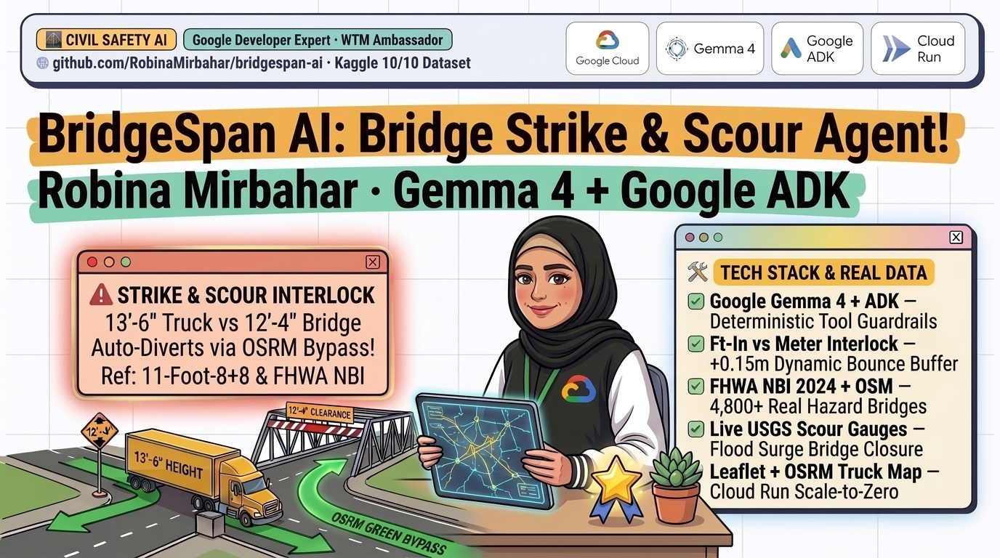
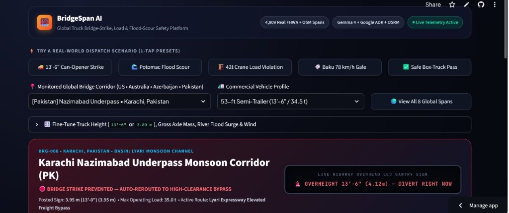

# Why Trucks Keep Hitting 11-Foot-8 Bridges — And How I Built BridgeSpan AI with Gemma 4 & Google ADK to Stop Them

### How I combined open-weights Gemma 4, Google ADK, OSRM heavy-truck routing, and 4,809 real FHWA & OpenStreetMap bridges into a mobile-responsive physical safety platform



**By Robina Mirbahar** — *AI/ML Google Developer Expert (GDE) | Google Cloud Champion Innovator*

- **Live Mobile-Responsive App:** https://bridgespan-ai-mvhoucpfp2n5o25dewb2hi.streamlit.app/
- **GitHub Open-Source Repository:** https://github.com/RobinaMirbahar/bridgespan-ai
- **Kaggle Open Dataset (4,809 Bridges):** https://www.kaggle.com/datasets/robinamirbahar/bridgespan-global-bridge-strike-load-scour
- **Companion Kaggle Starter Notebook:** https://www.kaggle.com/code/robinamirbahar/bridgespan-ai-2024-fhwa-nbi-scour-starter

---

Everyone has seen the viral clips of box trucks and 53-foot semi-trailers getting their roofs peeled open by Durham's famous **11-Foot-8+8 ("Can Opener")** rail trestle, Boston's **Storrow Drive**, or Melbourne's **Montague Street 3.0 m bridge**.

Behind the internet memes sits one of transportation engineering's costliest failure modes:

- **Thousands of low-clearance bridge strikes** happen every single year across the US, UK, Europe, and Australia—halting rail corridors and costing millions in structural steel repairs.
- **Hydraulic pier scour during flash floods** is the **#1 cause of highway bridge collapse in the United States** (accounting for over half of bridge failures tracked under FHWA Item 113).
- **Silent axle-load violations** occur daily when 42-ton mobile cranes or 34.5-ton freight haulers follow consumer GPS routes onto 15-ton parkway arches or 22.5-ton historic river trusses.

When you ask a raw LLM navigation assistant *"Can my 13'-6" trailer clear that 3.89 m underpass?"*, a single unit-conversion hallucination turns into twisted steel.

To solve this properly, I built and open-sourced **BridgeSpan AI**—a mobile-responsive fleet and civil-infrastructure safety platform powered by **Google's open-weights Gemma 4**, **Google Agent Development Kit (ADK)**, **OSRM heavy-truck routing**, and **4,809 real bridges** collected from the 2024 US DOT FHWA National Bridge Inventory, OpenStreetMap, USGS river gauges, and Copernicus GloFAS.



---

## Three Reasons Raw LLMs Fail on Physical Bridge Dispatch

When I benchmarked standard prompts against real heavy-freight scenarios, three failure modes stood out immediately:

1. **Imperial (`ft-in`) vs. Metric (`m`) Arithmetic Traps:** North American trailers declare height in feet and inches (`13'-6"` = `4.115 m`), whereas urban overpasses across Europe, Australia, Azerbaijan, and Pakistan post metric signs (`3.95 m` or `3.0 m`). Safe highway engineering also requires a mandatory **`0.15 m` (6-inch) dynamic suspension bounce and repaving buffer**.
2. **Height-Only Blindness to Structural Mass:** A compact `12'-0"` mobile crane (`42.0 metric tons`) easily clears a `14'-2"` historic truss vertically—even when the span's **FHWA Item 064 Operating Rating** is capped at `22.5 metric tons`.
3. **Invisible Underwater Pier Scour:** During a storm surge, a bridge deck looks completely normal on consumer maps while fast-moving floodwater scours sediment out from under **FHWA Item 113 scour-critical** piers.

---

## My Architecture: Gemma 4 Orchestration + 4 Deterministic Hard Gates

In safety-critical engineering, an AI model should orchestrate tools and communicate clearly with operators—never improvise structural physics in token space.

In **BridgeSpan AI**, every dispatch passes through four deterministic Python safety gates inside `bridgespan_agent/guardrails.py`:

- **Gate 1 — Overhead Clearance Interlock:** Deterministically parses `"13'-6\""`, `"12ft 4in"`, `"3.89 m"`, or `"389 cm"` into exact meters, adds the `0.15 m` suspension bounce buffer, and blocks the route if effective height exceeds posted clearance.
- **Gate 2 — Axle Load Interlock:** Compares gross vehicle tonnage against **FHWA Item 064** maximum operating rating.
- **Gate 3 — Flood Pier-Scour Closure:** Automatically locks **FHWA Item 113** scour-critical spans whenever live **USGS 15-minute river stage surge** reaches `>= +1.80 m`.
- **Gate 4 — Crosswind Rollover Protection:** Clamps high-sided trailers to `50 km/h` when live deck crosswind gusts reach `>= 65 km/h` (such as Caspian *Khazri* gales in Baku).

```python
if scour_tripped:          # Item 113 scour-critical pier + >= 1.80 m river stage surge
    status = "CLOSE_BRIDGE_SCOUR_INTERLOCK"
    use_detour = True
elif height_tripped:       # Vehicle height + 0.15 m bounce > posted clearance
    status = "DIVERT_OVERHEIGHT_STRIKE_PREVENTED"
    use_detour = True
elif weight_tripped:       # Gross vehicle tons > FHWA Item 064 operating rating
    status = "DIVERT_OVERWEIGHT_LOAD_LIMIT"
    use_detour = True
elif wind_tripped:         # High-sided trailer + >= 65 km/h deck gust
    status = "PROCEED_CLAMP_SPEED_50KMH"
    approved_speed = 50
else:
    status = "CLEAR_PRIMARY_ROUTE"
```

---

## Assembling a 100% Real Global Dataset (Published on Kaggle)

Rather than testing on synthetic toy numbers, I built an automated ingestion pipeline (`collect_bridgespan_dataset.py`) pulling directly from five authoritative public sources:

- **4,500 US Highway Bridges** from the official **2024 US DOT FHWA National Bridge Inventory** (`NC`, `NY`, `MA`, `PA`, `DC`, `MD`) with vertical clearances, Item 064 tonnage ratings, and Item 113 scour criticality.
- **309 Global Low-Clearance Spans** from the **OpenStreetMap Overpass API** across the US, UK, Australia, Pakistan, and Azerbaijan.
- **1,436 Live River Observations** from **USGS 15-minute instantaneous water gauges**.
- **360 Corridor-Days of Flood & Wind Data** from **Copernicus GloFAS** and **Open-Meteo**.
- **80 Heavy-Truck Benchmark Scenarios** with verified **OSRM** primary vs. safe bypass distances (`8/8` `pytest` suite passes with 100% agreement).

---

## Designing a Mobile-Responsive Fleet Safety Experience

Dispatchers sit in front of widescreen monitors, while field supervisors and drivers check routes on smartphones. Inspired by modern fleet telematics tools like Samsara, Hammer, and BridgeWatch, I built the Streamlit frontend (`app.py`) to work cleanly on both desktop and mobile:

- **1-Tap Real-World Scenario Presets** for Durham's `11-Foot-8+8` strike trap, Potomac river scour, a `42 t` crane overload, and Baku `78 km/h` crosswinds.
- **Overhead Highway LED Gantry Sign + Visual Progress Bars** showing exact clearance margin, load percentage, river surge, and safe detour distance—with zero developer JSON clutter.
- **Keyless Dark OpenStreetMap + OSRM Vector Routing** rendering blocked spans in dashed crimson and verified truck detours in emerald green.

---

## Deploy Serverlessly on Google Cloud Run in One Command

Because the repository ships with a production `Dockerfile`, deploying **BridgeSpan AI** to **Google Cloud Run** with scale-to-zero (`$0` idle cost) takes one command:

```bash
gcloud run deploy bridgespan-ai \
  --source . \
  --region us-central1 \
  --allow-unauthenticated \
  --min-instances 0
```

---

## Explore All Live Links & Fork the Blueprint

- **Try the Live App:** https://bridgespan-ai-mvhoucpfp2n5o25dewb2hi.streamlit.app/
- **GitHub Repository:** https://github.com/RobinaMirbahar/bridgespan-ai
- **Kaggle Dataset:** https://www.kaggle.com/datasets/robinamirbahar/bridgespan-global-bridge-strike-load-scour
- **Kaggle Starter Notebook:** https://www.kaggle.com/code/robinamirbahar/bridgespan-ai-2024-fhwa-nbi-scour-starter
