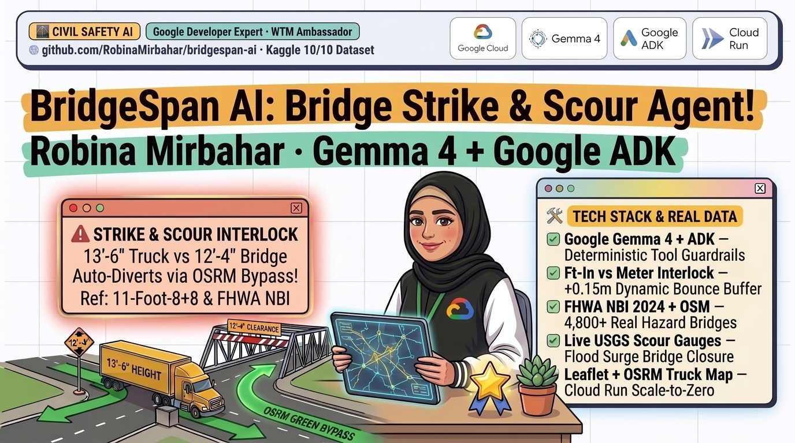
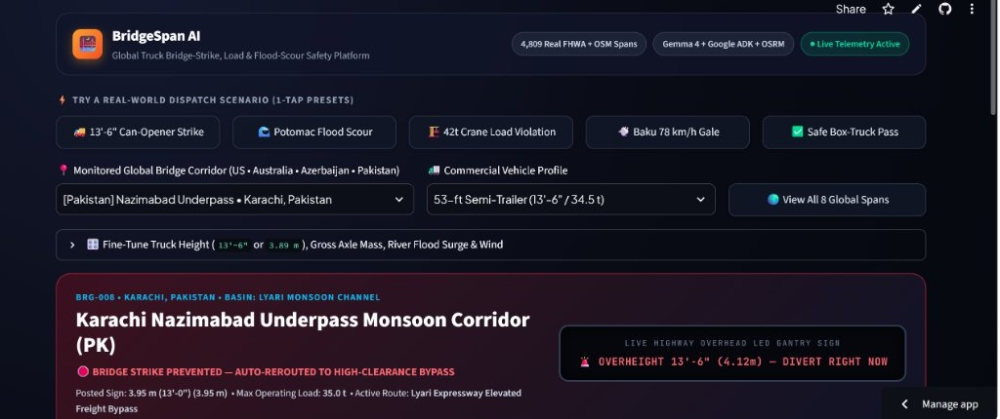
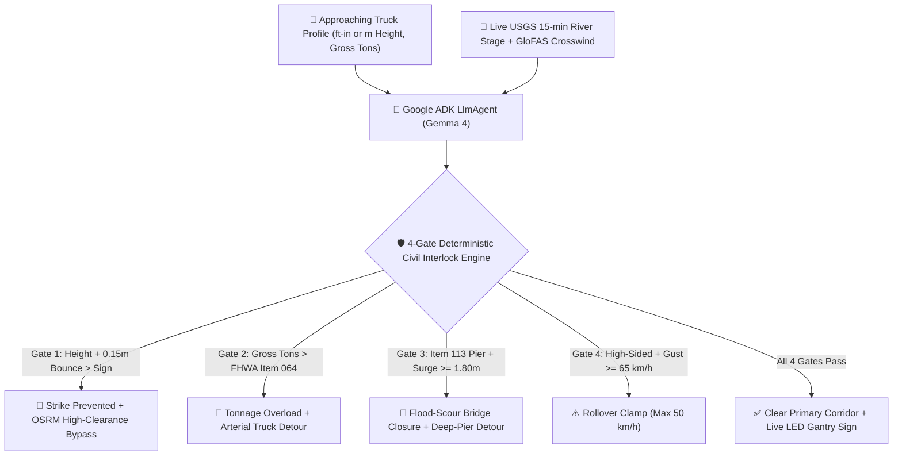

# 🌉 BridgeSpan AI — Global Truck Bridge-Strike, Load & Flood-Scour Safety Platform



[](https://bridgespan-ai-mvhoucpfp2n5o25dewb2hi.streamlit.app/)
[](https://google.github.io/adk-docs/)
[-0F9D58?logo=googlecloud)](https://ai.google.dev/gemma)
[](https://cloud.google.com/run)
[](https://www.kaggle.com/datasets/robinamirbahar/bridgespan-global-bridge-strike-load-scour)
[](https://www.kaggle.com/code/robinamirbahar/bridgespan-ai-2024-fhwa-nbi-scour-starter)

**Author:** Robina Mirbahar (*Google Developer Expert in AI/ML & Cloud*)

| Resource | Live Public Link |
| :--- | :--- |
| 🚀 **Live Mobile-Responsive Web App** | **[bridgespan-ai-mvhoucpfp2n5o25dewb2hi.streamlit.app](https://bridgespan-ai-mvhoucpfp2n5o25dewb2hi.streamlit.app/)** |
| 📊 **Kaggle Open Dataset (4,809 Spans)** | **[kaggle.com/datasets/robinamirbahar/bridgespan-global-bridge-strike-load-scour](https://www.kaggle.com/datasets/robinamirbahar/bridgespan-global-bridge-strike-load-scour)** |
| 📓 **Companion Kaggle Starter Notebook** | **[kaggle.com/code/robinamirbahar/bridgespan-ai-2024-fhwa-nbi-scour-starter](https://www.kaggle.com/code/robinamirbahar/bridgespan-ai-2024-fhwa-nbi-scour-starter)** |
| 💻 **Open-Source Blueprint** | **[github.com/RobinaMirbahar/bridgespan-ai](https://github.com/RobinaMirbahar/bridgespan-ai)** |

---

## 🚨 The Real-World Problem

Every year across the United States, Europe, Australia, and Asia, thousands of commercial semi-trailers, double-deck box trucks, and buses slam into low-clearance bridges—most famously Durham's **`11-foot-8+8` ("Can Opener") rail trestle**, Boston's **Storrow Drive**, New York's **Hutchinson River Parkway stone arches**, and Melbourne's **Montague Street 3.0 m overpass**. Beyond overhead strikes, **hydraulic pier scour** during flash-flood surges is the **#1 cause of highway bridge collapse in the United States** (FHWA Item 113), while overweight cranes and freight haulers routinely overstress aging load-posted trusses.

Raw LLM navigation assistants fail on physical bridge safety because they:
1. Hallucinate arithmetic across **Imperial (`13'-6"`, `12'-4"`) vs. Metric (`3.89 m`, `3.0 m`)** roadside signs and omit mandatory **`0.15 m` (`6 in`)** dynamic suspension bounce buffers.
2. Route heavy vehicles (`34.5 t`–`42.0 t`) across historic parkways or load-posted trusses (`15.0 t`–`22.5 t`).
3. Ignore live **USGS 15-minute river stage surges** acting on scour-critical bridge piers.

I built **BridgeSpan AI** to solve this end-to-end—pairing **Google ADK + Gemma 4** with **4-gate deterministic civil-engineering safety interlocks**, **live OSRM heavy-truck detour geometry on a mobile-responsive dark Leaflet map**, and a **100% real multi-source benchmark dataset**.



---

## 🏗️ System Architecture & 4-Gate Civil Safety Interlocks



---

## 📊 100% Real Multi-Source Dataset (`dataset/`)

All 5 CSV tables in `dataset/` were collected directly from authoritative public civil & hydrological APIs via `collect_bridgespan_dataset.py`:

| File | Rows | Real Upstream Source |
| :--- | ---: | :--- |
| `fhwa_nbi_2024_hazard_bridges.csv` | **4,500** | Official 2024 US DOT **FHWA National Bridge Inventory (NBI)** (`NC`, `NY`, `MA`, `PA`, `DC`, `MD`) |
| `osm_global_low_clearance_bridges.csv` | **309** | **OpenStreetMap Overpass API** global `maxheight` bridges (`US`, `UK`, `AU`, `PK`, `AZ`) |
| `usgs_live_river_scour_telemetry.csv` | **1,436** | **USGS NWIS** 15-minute instantaneous river stage (`00065`) & discharge (`00060`) |
| `global_glofas_flood_and_wind_daily.csv` | **360** | **Copernicus GloFAS** river discharge + **Open-Meteo** wind gusts & precipitation |
| `bridgespan_dispatch_benchmark_80.csv` | **80** | Verified 80-scenario heavy-truck benchmark with real **OSRM** primary vs. safe bypass distances |

---

## 🚀 Quickstart (Local, Streamlit Cloud & Google Cloud Run)

```bash
git clone https://github.com/RobinaMirbahar/bridgespan-ai.git
cd bridgespan-ai
pip install -r requirements.txt

# 1. Verify all 80 benchmark scenarios & Imperial/Metric guardrails (8/8 passed)
pytest -v

# 2. Launch the mobile-responsive fleet safety web app
streamlit run app.py
```

### Deploy Scale-to-Zero on Google Cloud Run

```bash
gcloud run deploy bridgespan-ai \
  --source . \
  --region us-central1 \
  --allow-unauthenticated \
  --min-instances 0
```
